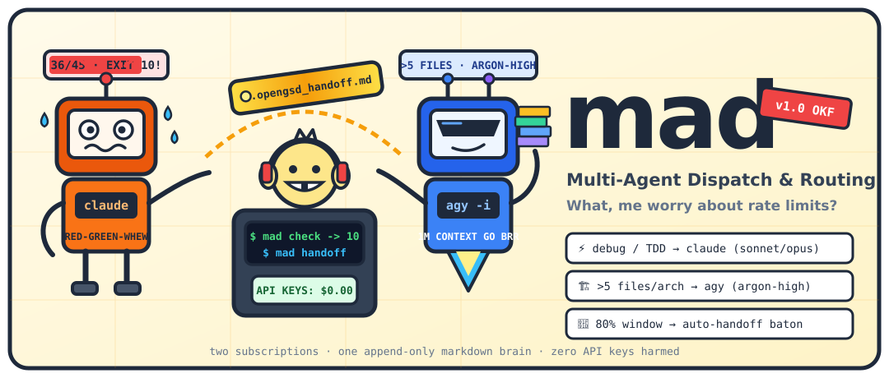

<p align="center">
  <picture>
    <source media="(prefers-color-scheme: dark)" srcset="docs/assets/logo-dark.svg">
    
  </picture>
</p>

# mad

**What, me worry about rate limits?**

`mad` (**M**ulti-**A**gent **I**ntelligent **O**rchestration & **R**outing **S**ystem) is a zero-dependency local dispatcher for developers who carry two flat-rate AI subscriptions—**Claude Code Pro** (`claude`) and **Google AI Ultra** (`agy`)—and refuse to pay per-token API bills or lose context when a 5-hour quota wall hits mid-session.

It scores every task deterministically, dispatches it to the right CLI and model tier, feeds agents *only* the context files they need, and passes a structured `.opengsd_handoff.md` baton across CLIs before a rate limit cuts your work in half.

```
Prompt + Files ──► mad route / run
                    ├─ Tight TDD / debug / ≤5 files ──► claude (--model haiku | sonnet | opus)
                    └─ Architecture / ontology / >5 files ──► agy (--model gemini-3.8-flash-medium | gemini-4-argon-high -i)
                                                               │
   ~/.claude/projects/*/*.jsonl ──► mad check (36/45 = 80%) ───┤
   UserPromptSubmit Hook        ──► context_orchestrator       ▼
                                    (.opengsd_handoff.md) ──► mad handoff ──► agy picks up mid-stride
```

## Why this exists

| Without `mad` | With `mad` |
|---|---|
| You burn Opus/Sonnet messages on README typos or 12-file refactors | `mad route` / `mad run` sends typos to `haiku`, TDD loops to `sonnet`, heisenbugs to `opus`, and >5-file / architecture work to `agy` (`gemini-4-argon-high`) |
| Every session loads your entire repo docs and blows the context window | `mad fetch <keywords>` scores `.active_context/*.md` by frontmatter keywords (2 pts) and title words (1 pt) within a 24 KB byte budget |
| Claude hits its 5-hour message cap mid-debug and your next steps vanish | `mad check` + `.claude/settings.json` hook detect 80% usage (`36/45` messages) and trigger `context_orchestrator` to write `.opengsd_handoff.md` |
| Switching from `claude` to `agy` means copy-pasting terminal scrollback | `mad handoff` validates `.opengsd_handoff.md` and launches `agy --model gemini-4-argon-high -i "$(cat .opengsd_handoff.md)"` in one command |

## Quickstart (2 minutes)

**Requirements:** Linux/macOS, `bash`, and Python 3.11+ (stdlib only—zero `pip install` needed at runtime).

```bash
# 1. Initialize the OKF Markdown store (.global_dev_log.md + .active_context/INDEX.md)
bin/mad init

# 2. Inspect how a task will be routed (JSON decision, launches nothing)
bin/mad route "debug the mqtt reconnect loop" src/client.py
# -> {"agent": "claude", "model": "sonnet", "reasons": ["kw:debug"], "scores": {"claude": 1, "agy": 0}}

bin/mad route "design the BFO ontology tree" a.py b.py c.py d.py e.py f.py
# -> {"agent": "agy", "model": "gemini-4-argon-high", "reasons": ["kw:design", "kw:ontology", "kw:bfo", "files:6>5"], "scores": {"claude": 0, "agy": 4}}

# 3. Dry-run or launch the chosen CLI (logs a transition entry to .global_dev_log.md)
bin/mad run --dry-run "design the UNS tree"
# -> agy --model gemini-4-argon-high -i 'design the UNS tree'

# 4. Check subscription window capacity (exits 0 = ok, 10 = handoff needed)
bin/mad check

# 5. Optional: symlink the 3 shared skills into ~/.claude/skills and ~/.gemini/config/skills
scripts/install-skills.sh --dry-run
```

## Use Cases at a Glance

1. **Tight RED-GREEN-REFACTOR Debugging (`claude` + `sonnet`)** — Fast single-file test/fix loops stay on Claude Sonnet.
2. **Deep Concurrency / Memory Heisenbugs (`claude` + `opus`)** — Prompts mentioning `race condition`, `deadlock`, `heisenbug`, `memory corruption`, or `--deep` escalate automatically to Claude Opus.
3. **Zero-Guilt Chores (`claude` + `haiku`)** — `docstring`, `readme`, `changelog`, `regex`, `lint`, `format`, and `typo` prompts with no debug signal drop to Claude Haiku.
4. **Multi-File Architecture & Ontologies (`agy` + `gemini-4-argon-high`)** — Tasks spanning `>5` files or matching `design`, `architect`, `refactor all`, `ontology`, `bfo`, `cco`, `unified namespace`, or `uns` route to Google AI Ultra (`agy`).
5. **"Just Enough Context" Retrieval (`mad fetch`)** — Pull only matching `.active_context/*.md` domain notes into the agent's context window within a strict byte budget (`24,000` bytes default).
6. **Pre-Limit Baton Pass (`mad check` → `mad handoff --write` → `mad handoff`)** — Automatically catch the 80% 5-hour Claude window (`36/45` prompts) via the `.claude/settings.json` `UserPromptSubmit` hook, write a validated `.opengsd_handoff.md`, and resume in `agy`.

## Documentation

- **[Comprehensive User Guide (`docs/user-guide/README.md`)](docs/user-guide/README.md)** — Full walkthroughs, 7 end-to-end use cases, CLI & config reference, OKF file schemas, skill guides, and troubleshooting.
- **[System Design Specification (`docs/superpowers/specs/2026-10-23-mad-design.md`)](docs/superpowers/specs/2026-10-23-mad-design.md)** — Architectural decisions, scoring tables, and environment facts.
- **[Agent Briefing (`AGENTS.md`)](AGENTS.md)** — Invariants and instructions for `claude`, `agy`, `opencode`, and `codex`.

## Verification

```bash
pytest -q                                                                                # 37 unit tests
bats tests/cli.bats                                                                      # 15 CLI & hook integration tests
shellcheck bin/mad tests/stub_cli.sh scripts/install-skills.sh scripts/claude-check-hook.sh  # bash lint
```
