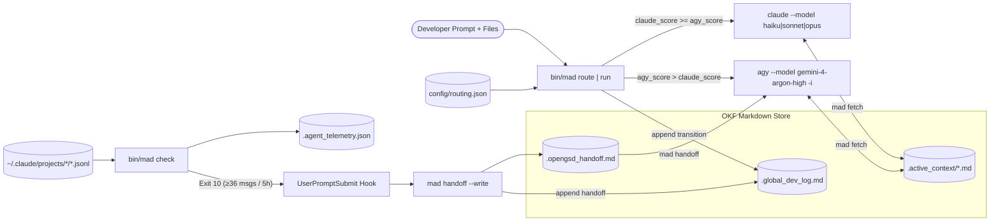

# `mad` User Guide

[← Back to Project README](../../README.md)

Welcome to the comprehensive user guide for **`mad`** (**M**ulti-**A**gent **I**ntelligent **O**rchestration & **R**outing **S**ystem). This guide covers installation, core concepts, 7 end-to-end use-case walkthroughs, complete CLI/configuration reference, and troubleshooting.

---

## Table of Contents

- [Getting Started](#getting-started)
  - [Prerequisites](#prerequisites)
  - [Installation & Repository Setup](#installation--repository-setup)
  - [Two-Minute First Run](#two-minute-first-run)
- [Core Concepts & Architecture](#core-concepts--architecture)
  - [1. OKF Markdown State Store](#1-okf-markdown-state-store)
  - [2. Deterministic Routing & Model Tiering](#2-deterministic-routing--model-tiering)
  - [3. Just-Enough-Context Fetcher](#3-just-enough-context-fetcher)
  - [4. Limit Telemetry & Zero-Loss Handoff](#4-limit-telemetry--zero-loss-handoff)
- [Use Cases & Step-by-Step Examples](#use-cases--step-by-step-examples)
  - [Use Case 1: Tight TDD & Debugging Loop (Claude Sonnet)](#use-case-1-tight-tdd--debugging-loop-claude-sonnet)
  - [Use Case 2: Escalating Deep Bugs & Race Conditions (Claude Opus)](#use-case-2-escalating-deep-bugs--race-conditions-claude-opus)
  - [Use Case 3: Offloading Docs, Regex & Lint Chores (Claude Haiku)](#use-case-3-offloading-docs-regex--lint-chores-claude-haiku)
  - [Use Case 4: Multi-File Refactoring & Ontology Architecture (Agy Argon High)](#use-case-4-multi-file-refactoring--ontology-architecture-agy-argon-high)
  - [Use Case 5: Selective Domain Context Loading (`mad fetch`)](#use-case-5-selective-domain-context-loading-mad-fetch)
  - [Use Case 6: Pre-Limit Handoff from Claude to Agy (`mad handoff`)](#use-case-6-pre-limit-handoff-from-claude-to-agy-mad-handoff)
  - [Use Case 7: Handling Agy Concurrency & Rate-Limit Cooldowns](#use-case-7-handling-agy-concurrency--rate-limit-cooldowns)
- [Reference](#reference)
  - [CLI Subcommands & Flags](#cli-subcommands--flags)
  - [Configuration Schema (`config/routing.json`)](#configuration-schema-configroutingjson)
  - [State File Formats](#state-file-formats)
  - [Shared Agent Skills](#shared-agent-skills)
  - [Environment Variables](#environment-variables)
  - [Exit Codes](#exit-codes)
- [Troubleshooting & FAQ](#troubleshooting--faq)

---

## Getting Started

### Prerequisites

- **OS & Shell:** Linux or macOS with `bash`.
- **Python:** Python 3.11+ (`python3`). Runtime code uses **only the Python standard library**—no virtual environment or `pip install` is required to run `bin/mad`.
- **Subscription CLIs:**
  - `claude` (Claude Code CLI, authenticated with Claude Pro/Max)
  - `agy` (Antigravity CLI, authenticated with Google AI Ultra)
- **Test/Lint Tools (for development only):** `pytest`, `bats`, `shellcheck`.

### Installation & Repository Setup

Add `bin/mad` to your `PATH` (or invoke it directly from the repository), initialize the state store in your project root, and optionally install the shared skills into your user home:

```bash
# 1. Initialize .active_context/INDEX.md and .global_dev_log.md in the current repo
bin/mad init

# 2. Preview skill symlinks for ~/.claude/skills and ~/.gemini/config/skills
scripts/install-skills.sh --dry-run

# 3. Create the symlinks when ready
scripts/install-skills.sh
```

### Two-Minute First Run

Verify routing, logging, context fetching, and telemetry without launching a live agent session:

```bash
# 1. Route a prompt and inspect the JSON decision
bin/mad route "write tests for the parser" src/parser.py
# Output:
# {"agent": "claude", "model": "sonnet", "reasons": ["kw:write test", "kw:write tests"], "scores": {"claude": 2, "agy": 0}}

# 2. Preview the exact CLI command that mad run would execute
bin/mad run --dry-run "write tests for the parser" src/parser.py
# Output:
# claude --model sonnet 'write tests for the parser src/parser.py'

# 3. Record an architectural decision in the append-only log
bin/mad log --kind decision --agent human --field module=parser "Use recursive descent for expressions"

# 4. Run a capacity check (writes .agent_telemetry.json and prints ok or handoff)
bin/mad check
# Output:
# ok
```

---

## Core Concepts & Architecture



### 1. OKF Markdown State Store

Instead of SQLite or Redis (which require bridge tooling for LLM agents), `mad` stores all shared state as **OKF (Open Knowledge Format) Markdown**—YAML frontmatter (`title`, `keywords`, `updated`) followed by structured Markdown sections that any agent can `grep` and read natively:

- **`.global_dev_log.md`**: Strictly **append-only** chronological log of every task (`task`), CLI launch (`transition`), architectural choice (`decision`), agent switch (`handoff`), and note (`note`).
- **`.active_context/`**: Modular domain topic files (`snake_case.md`) plus an auto-generated `INDEX.md`.
- **`.opengsd_handoff.md`**: Synthesized relay baton containing the exact four sections required to resume work in another CLI without losing state.

### 2. Deterministic Routing & Model Tiering

`mad route` and `mad run` score the prompt text (case-insensitive word-boundary phrase matching) and file count using rules in [`config/routing.json`](../../config/routing.json):

```
claude_score = count of distinct claude_keywords matched in prompt
agy_score    = count of distinct agy_keywords matched in prompt
             + (1 if len(files) > agy_file_threshold [5])
```

- **Agent Selection:**
  - If `--agent claude|agy` is passed, the override wins (`override:agent`).
  - If `agy_score > claude_score`, **`agy`** wins.
  - Otherwise (including ties and zero-signal prompts), **`claude`** wins—keeping the cheaper, faster terminal loop as the default.

- **Model Selection Table:**

| Chosen Agent | Condition (first match wins) | Selected Model |
|---|---|---|
| `claude` | `--model <M>` CLI flag | `<M>` (`override:model`) |
| `claude` | Prompt matches any `opus_keywords` (`deep bug`, `race condition`, `deadlock`, `heisenbug`, `memory corruption`, `--deep`) | `opus` |
| `claude` | Prompt matches any `haiku_keywords` (`docstring`, `readme`, `changelog`, `regex`, `lint`, `format`, `typo`) **and** `claude_score == 0` | `haiku` |
| `claude` | Default | `sonnet` |
| `agy` | `--model <M>` CLI flag | `<M>` (`override:model`) |
| `agy` | `agy_score == 0` (selected only via `--agent agy` override) | `gemini-3.8-flash-medium` |
| `agy` | Default (`agy_score > 0`) | `gemini-4-argon-high` |

### 3. Just-Enough-Context Fetcher

Loading every architecture doc into every prompt wastes subscription quota and degrades reasoning. `bin/mad fetch KEYWORD...` scores each `.active_context/*.md` file (excluding `INDEX.md`):

- **+2 points** for each distinct query token matching a frontmatter `keywords` entry.
- **+1 point** for each distinct query token matching a word in the frontmatter `title`.
- Positive-score files are sorted by `(-score, filename)` and emitted until adding a file would exceed `fetch_budget_bytes` (default `24,000` bytes). If a high-scoring file exceeds the remaining budget, `mad fetch` skips it and continues checking smaller lower-scored files that still fit.

### 4. Limit Telemetry & Zero-Loss Handoff

Because Claude Pro does not expose an API quota endpoint, `mad check` estimates account-wide 5-hour window usage by scanning user prompts across `~/.claude/projects/*/*.jsonl` (excluding `isMeta: true` and `tool_result`-only turns) within the last `window_hours` (`5` hours).

`mad check` atomically writes `.agent_telemetry.json` and exits **`10` (`handoff`)** when any of the following hold:
1. `claude.messages_in_window >= ceil(window_message_budget * handoff_ratio)` (default `ceil(45 * 0.8) = 36` messages in 5 hours).
2. `agy.running >= agy.max_concurrent` (default `2` concurrent processes).
3. `agy.last_rate_limit` was recorded within the last `15` minutes.
4. `MAD_FORCE_HANDOFF=1` is set in the environment.

When Claude Code runs in this repository, the project hook in [`.claude/settings.json`](../../.claude/settings.json) runs [`scripts/claude-check-hook.sh`](../../scripts/claude-check-hook.sh) on every `UserPromptSubmit`. If `mad check` exits `10`, the hook injects a system instruction telling Claude to immediately run `context_orchestrator` (`bin/mad handoff --write ...`), halt, and let you launch `bin/mad handoff`.

---

## Use Cases & Step-by-Step Examples

### Use Case 1: Tight TDD & Debugging Loop (Claude Sonnet)

**Scenario:** A unit test is failing on a single module and you want a fast red-green-refactor loop.

```bash
$ bin/mad route "debug failing test in reconnect handler" src/mqtt.py tests/test_mqtt.py
{"agent": "claude", "model": "sonnet", "reasons": ["kw:debug", "kw:failing test"], "scores": {"claude": 2, "agy": 0}}

$ bin/mad run --dry-run "debug failing test in reconnect handler" src/mqtt.py tests/test_mqtt.py
claude --model sonnet 'debug failing test in reconnect handler src/mqtt.py tests/test_mqtt.py'
```

When run without `--dry-run`, `mad run` appends a `transition` entry to `.global_dev_log.md` and `exec`s `claude`.

### Use Case 2: Escalating Deep Bugs & Race Conditions (Claude Opus)

**Scenario:** You suspect a subtle lock-ordering deadlock or memory corruption that warrants Opus reasoning depth.

```bash
$ bin/mad route "debug the race condition in worker pool shutdown" src/pool.py
{"agent": "claude", "model": "opus", "reasons": ["kw:debug", "kw:race condition"], "scores": {"claude": 1, "agy": 0}}
```

You can also trigger Opus explicitly inside any prompt by including `--deep`:

```bash
$ bin/mad route -- "investigate the intermittent state mismatch --deep" src/state.py
{"agent": "claude", "model": "opus", "reasons": ["default", "kw:--deep"], "scores": {"claude": 0, "agy": 0}}
```

### Use Case 3: Offloading Docs, Regex & Lint Chores (Claude Haiku)

**Scenario:** You want to clean up docstrings, fix a typo in `README.md`, or draft a regex without spending Sonnet/Opus quota.

```bash
$ bin/mad route "update docstring and fix typo in readme" README.md
{"agent": "claude", "model": "haiku", "reasons": ["default", "kw:docstring", "kw:readme", "kw:typo"], "scores": {"claude": 0, "agy": 0}}
```

> **Note:** If a prompt mixes a Haiku keyword with a debugging keyword (e.g., `"debug the regex parser"`), `claude_score > 0` prevents downgrading to Haiku and keeps the task on `sonnet`.

### Use Case 4: Multi-File Refactoring & Ontology Architecture (Agy Argon High)

**Scenario:** You are designing a Unified Namespace (UNS) schema, working with BFO/CCO ontologies, or refactoring more than 5 files at once.

```bash
$ bin/mad route "architect the unified namespace BFO mapping" \
    src/a.py src/b.py src/c.py src/d.py src/e.py src/f.py
{"agent": "agy", "model": "gemini-4-argon-high", "reasons": ["kw:architect", "kw:bfo", "kw:unified namespace", "files:6>5"], "scores": {"claude": 0, "agy": 4}}

$ bin/mad run --dry-run "architect the unified namespace BFO mapping" \
    src/a.py src/b.py src/c.py src/d.py src/e.py src/f.py
agy --model gemini-4-argon-high -i 'architect the unified namespace BFO mapping src/a.py src/b.py src/c.py src/d.py src/e.py src/f.py'
```

If you want `agy`'s lighter, faster tier (`gemini-3.8-flash-medium`) for quick file scaffolding where no heavy architecture keywords apply, pass `--agent agy`:

```bash
$ bin/mad route --agent agy "scaffold boilerplate config files"
{"agent": "agy", "model": "gemini-3.8-flash-medium", "reasons": ["override:agent"], "scores": {"claude": 0, "agy": 0}}
```

### Use Case 5: Selective Domain Context Loading (`mad fetch`)

**Scenario:** Your repository has several domain notes in `.active_context/`, and you want the agent to load only the files relevant to `docker` and `mqtt`.

```bash
# 1. Create two topic files in .active_context/
cat > .active_context/mqtt_topology.md <<'EOF'
---
title: MQTT Broker Topology
keywords: [mqtt, broker, uns]
updated: 2026-10-23
---

Broker runs on port 1883 with TLS on 8883.
EOF

cat > .active_context/ui_theme.md <<'EOF'
---
title: UI Theme Tokens
keywords: [css, react, theme]
updated: 2026-10-23
---

Use semantic CSS variables.
EOF

# 2. Regenerate .active_context/INDEX.md
bin/mad fetch --reindex
# Output:
# .active_context/INDEX.md

# 3. Query only the context needed for an MQTT task
bin/mad fetch mqtt broker
# Output:
# .active_context/mqtt_topology.md
```

### Use Case 6: Pre-Limit Handoff from Claude to Agy (`mad handoff`)

**Scenario:** Claude is at `36/45` messages in the 5-hour window (`mad check` exits `10`). You (or the `context_orchestrator` skill) package the unresolved state into `.opengsd_handoff.md` and launch `agy` with one command.

```bash
# 1. Write the validated OKF handoff file and append a handoff entry to .global_dev_log.md
bin/mad handoff --write \
  --agent claude \
  --problem "MQTT reconnect backoff timer resets prematurely on PUBACK" \
  --step "Update BackoffTimer.on_puback() in src/mqtt.py to checkinflight count" \
  --step "Run pytest tests/test_mqtt.py -k backoff" \
  --context ".active_context/mqtt_topology.md" \
  --verify "pytest -q"
# Output:
# .opengsd_handoff.md

# 2. Preview the exact agy launch command
bin/mad handoff --dry-run
# Output:
# agy --model gemini-4-argon-high -i '---
# title: Session handoff
# keywords: [handoff, state]
# updated: 2026-10-23
# ---
# ...'

# 3. Launch agy with the handoff prompt injected via -i
bin/mad handoff
```

### Use Case 7: Handling Agy Concurrency & Rate-Limit Cooldowns

**Scenario:** `agy` hits a rate limit on Google AI Ultra or already has 2 heavy sessions running.

```bash
# Record an agy rate-limit event (sets agy.last_rate_limit in .agent_telemetry.json)
bin/mad check --record-rate-limit
# Output:
# handoff   (exit code 10 for the next 15 minutes)

# Or test concurrency limit gating when 2 agy processes are active
MAD_AGY_RUNNING=2 bin/mad check
# Output:
# handoff   (exit code 10)
```

---

## Reference

### CLI Subcommands & Flags

| Subcommand | Syntax | Description |
|---|---|---|
| `init` | `bin/mad init` | Creates `.active_context/INDEX.md` and `.global_dev_log.md` if missing. Idempotent; never overwrites existing files. |
| `route` | `bin/mad route [--agent claude\|agy] [--model M] PROMPT [FILE...]` | Evaluates routing rules and prints the `Decision` JSON (`agent`, `model`, `reasons`, `scores`). Launches nothing. |
| `run` | `bin/mad run [--agent claude\|agy] [--model M] [--dry-run] PROMPT [FILE...]` | Routes the task, appends a `transition` entry to `.global_dev_log.md`, and `exec`s the target CLI. `--dry-run` prints the shell-quoted `argv` and writes nothing. |
| `log` | `bin/mad log --kind KIND --agent AGENT [--field k=v]... MESSAGE` | Appends one entry to `.global_dev_log.md`. `KIND` ∈ `{task, transition, decision, handoff, note}`; `AGENT` ∈ `{claude, agy, human, mad}`. |
| `fetch` | `bin/mad fetch [--reindex] [--budget BYTES] [KEYWORD...]` | Scores `.active_context/*.md` against `KEYWORD...` within `--budget` (default `24000`). `--reindex` regenerates `.active_context/INDEX.md`. |
| `handoff` (write) | `bin/mad handoff --write --agent AGENT --problem TEXT --step STEP... [--context PATH...] [--verify CMD...] [--file PATH]` | Atomically writes `.opengsd_handoff.md` with the 4 required OKF sections and appends a `handoff` entry to `.global_dev_log.md`. |
| `handoff` (launch) | `bin/mad handoff [--model M] [--file PATH] [--dry-run]` | Validates `.opengsd_handoff.md` and `exec`s `agy --model M -i "<content>"` (default model: `gemini-4-argon-high`). |
| `check` | `bin/mad check [--transcripts-dir PATH] [--record-rate-limit]` | Updates `.agent_telemetry.json` atomically and prints `ok` (exit `0`) or `handoff` (exit `10`). |

> **Tip:** If your `PROMPT` starts with a dash (e.g., `"-v flag is broken"`), place `--` before the prompt: `bin/mad route -- "-v flag is broken"`.

### Configuration Schema (`config/routing.json`)

[`config/routing.json`](../../config/routing.json) controls all keywords, thresholds, model IDs, byte budgets, and telemetry limits:

```json
{
  "claude_keywords": ["debug", "write test", "write tests", "fix error", "fix the error", "failing test", "red-green", "tdd", "stack trace"],
  "agy_keywords": ["design", "architect", "architecture", "refactor all", "ontology", "bfo", "cco", "unified namespace", "uns", "documentation set"],
  "opus_keywords": ["deep bug", "race condition", "deadlock", "heisenbug", "memory corruption", "--deep"],
  "haiku_keywords": ["docstring", "readme", "changelog", "regex", "lint", "format", "typo"],
  "agy_file_threshold": 5,
  "fetch_budget_bytes": 24000,
  "models": {
    "claude": {"light": "haiku", "default": "sonnet", "deep": "opus"},
    "agy": {"light": "gemini-3.8-flash-medium", "heavy": "gemini-4-argon-high"}
  },
  "telemetry": {
    "window_hours": 5,
    "window_message_budget": 45,
    "handoff_ratio": 0.8,
    "agy_max_concurrent": 2,
    "agy_rate_limit_cooldown_minutes": 15
  }
}
```

### State File Formats

#### 1. `.global_dev_log.md`
```markdown
---
title: Global dev log
keywords: [log, history, decisions, handoffs]
updated: 2026-10-23
---

# Global dev log

Append-only. Newest entries at the bottom.

## 2026-10-23T14:02:11Z · transition · claude
- task: debug the mqtt reconnect
- model: sonnet
- reasons: kw:debug
```

#### 2. `.opengsd_handoff.md`
Must begin with OKF YAML frontmatter and contain these four `##` headings in order:
- `## Unresolved problem`
- `## Next exact steps`
- `## Context files to load`
- `## Verify with`

#### 3. `.agent_telemetry.json`
```json
{
  "version": 1,
  "updated": "2026-10-23T15:00:00Z",
  "claude": {
    "window_hours": 5,
    "window_message_budget": 45,
    "handoff_ratio": 0.8,
    "messages_in_window": 12,
    "oldest_in_window": "2026-10-23T11:00:00Z"
  },
  "agy": {
    "max_concurrent": 2,
    "running": 0,
    "last_rate_limit": null
  }
}
```

### Shared Agent Skills

Located in [`skills/`](../../skills/) and installed via [`scripts/install-skills.sh`](../../scripts/install-skills.sh):
- **[`context_fetcher`](../../skills/context_fetcher/SKILL.md)**: Runs `bin/mad fetch <keywords>` before starting a domain task and loads only the returned `.active_context/*.md` files.
- **[`context_orchestrator`](../../skills/context_orchestrator/SKILL.md)**: Extracts the `git diff --stat` and log delta since the last handoff and runs `bin/mad handoff --write ...`.
- **[`route_task`](../../skills/route_task/SKILL.md)**: Runs `bin/mad check` before major work and applies the subagent model-tier table (`haiku`/`sonnet`/`opus` in Claude; `gemini-3.8-flash-medium`/`gemini-4-argon-high` in `agy`).

### Environment Variables

| Variable | Default | Purpose |
|---|---|---|
| `MAD_CLAUDE_BIN` | `claude` | Path or command name for the Claude Code binary. |
| `MAD_AGY_BIN` | `agy` | Path or command name for the Antigravity CLI binary. |
| `MAD_CLAUDE_PROJECTS_DIR` | `~/.claude/projects` | Directory scanned for `*/*.jsonl` transcripts by `mad check`. |
| `MAD_AGY_RUNNING` | *(from `.agent_telemetry.json`)* | Integer override for `agy.running` in `mad check`. |
| `MAD_FORCE_HANDOFF` | unset | When set to `1`, forces `mad check` to print `handoff` and exit `10`. |
| `MAD_CLAUDE_SKILLS_DIR` | `~/.claude/skills` | Target directory for Claude skills in `scripts/install-skills.sh`. |
| `MAD_AGY_SKILLS_DIR` | `~/.gemini/config/skills` | Target directory for `agy` skills in `scripts/install-skills.sh`. |

### Exit Codes

| Code | Meaning |
|---|---|
| `0` | Success (`ok` in `mad check`). |
| `1` | Runtime or validation error (e.g., missing/malformed `.opengsd_handoff.md`, invalid log kind/agent, real directory collision in `install-skills.sh`). |
| `2` | CLI usage / argument parsing error. |
| `10` | Capacity threshold reached (`handoff` in `mad check`). |

---

## Troubleshooting & FAQ

### `mad: handoff file not found: .../.opengsd_handoff.md` (Exit 1)
- **Cause:** `bin/mad handoff` was run before `.opengsd_handoff.md` was generated.
- **Fix:** Generate the handoff file first with `bin/mad handoff --write --agent claude --problem "..." --step "..."`.

### `mad: malformed handoff file: .../.opengsd_handoff.md` (Exit 1)
- **Cause:** `.opengsd_handoff.md` was edited by hand and is missing the OKF `---` frontmatter block or one of the four required headings (`## Unresolved problem`, `## Next exact steps`, `## Context files to load`, `## Verify with`).
- **Fix:** Regenerate it using `bin/mad handoff --write ...`.

### `install-skills.sh: refusing to overwrite real directory: ...` (Exit 1)
- **Cause:** One of the target skill paths in `~/.claude/skills/<name>` or `~/.gemini/config/skills/<name>` is a real directory rather than a symlink.
- **Fix:** Move or remove the conflicting directory, then re-run `scripts/install-skills.sh`.

### Why does `mad handoff` use `agy -i` instead of `agy --file`?
- The `agy` CLI does not have a `--file` flag. `mad handoff` validates `.opengsd_handoff.md` and passes its contents via `agy --model gemini-4-argon-high -i "<content>"`.
